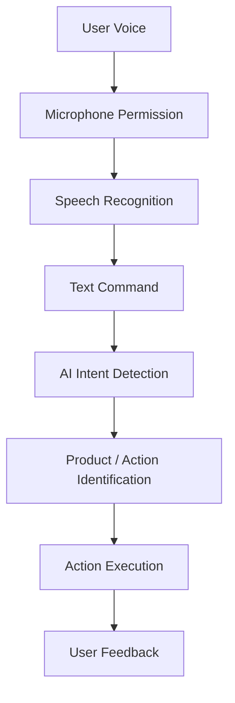
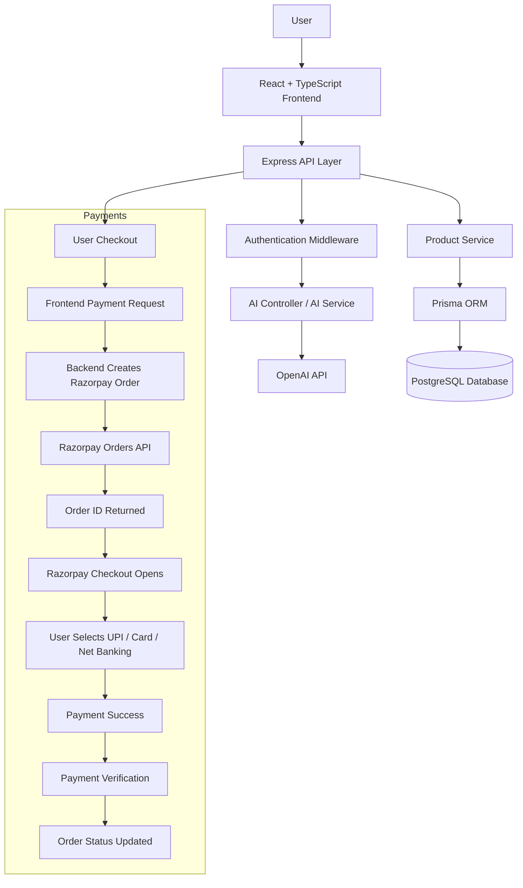
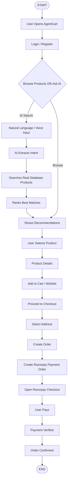
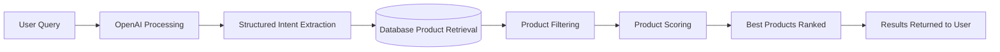
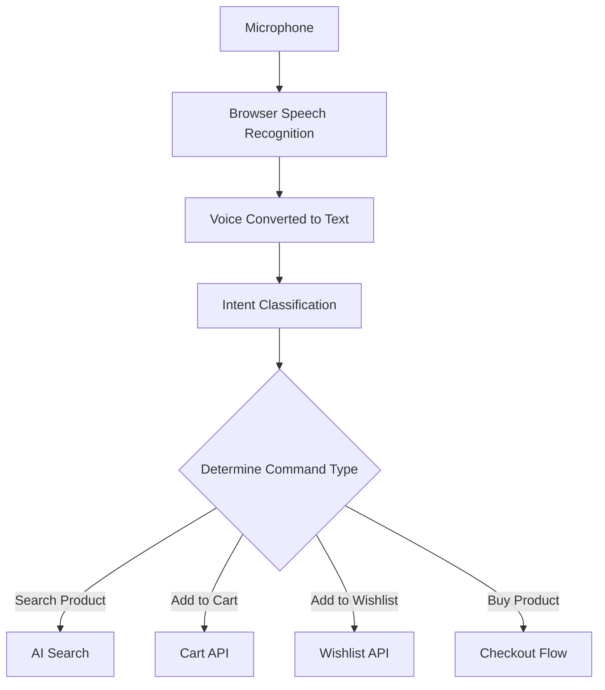
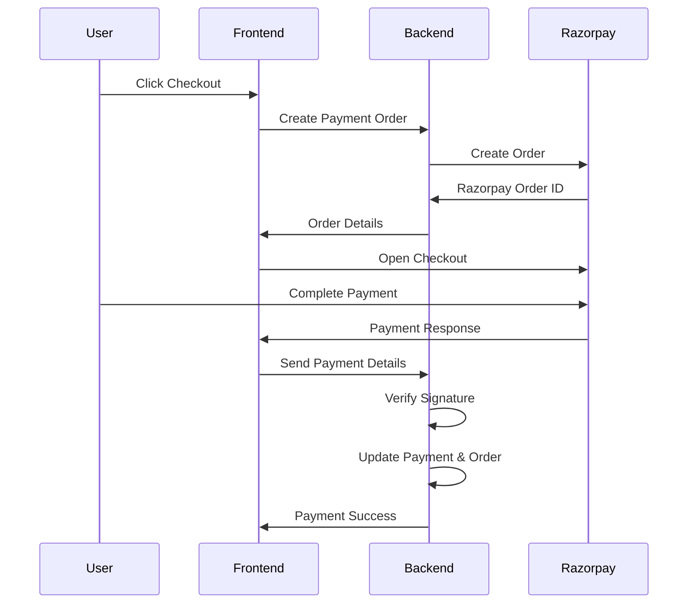
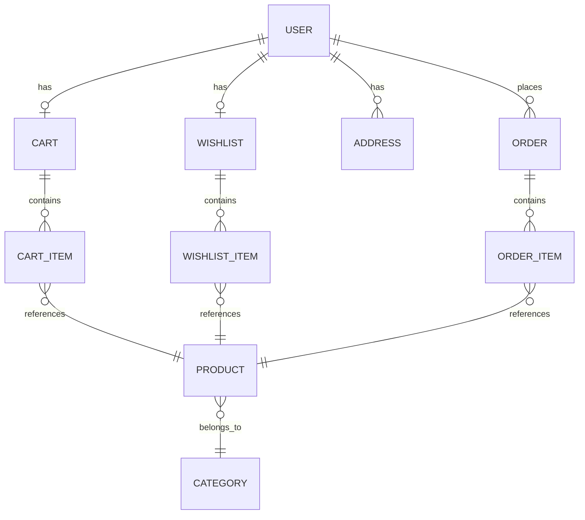

AgentCart
An AI-powered shopping assistant that helps users discover, decide, and purchase products naturally.


---
Problem Statement
Online shopping today is still largely a manual, click-driven process, and that creates real friction for users:
Users spend too much time searching manually — scrolling through pages of products to find what they actually want.
Product filters can be complicated — most e-commerce filters require users to know exact categories, brands, or price brackets in advance.
Users may not know the correct keywords — a search for "shoes for running" may miss listings tagged only as "sports footwear."
Comparing products takes effort — users must open multiple tabs and manually judge which product fits their budget and needs.
Shopping websites usually do not understand natural language — a query like "black running shoes under ₹5000" is typically not understood as a combination of category, color, and budget.
Voice-based shopping actions are limited — very few platforms let users search, add to cart, or check out using natural speech.
Users need to manually perform multiple steps before checkout — search → filter → compare → add to cart → checkout is a long, repetitive journey.
AgentCart is built to remove this friction by adding an intelligent layer on top of traditional e-commerce.
---
Our Solution
AgentCart acts as an AI shopping layer on top of a real e-commerce catalog. Instead of forcing users to manually search and filter, users simply express what they want — by typing or speaking — and AgentCart's AI understands the intent and acts on it.
High-level flow:
```
User Intent
   ↓
AI Understanding
   ↓
Product Discovery
   ↓
Product Ranking
   ↓
Recommendation
   ↓
Cart / Wishlist Action
   ↓
Checkout
   ↓
Razorpay Payment
   ↓
Order Confirmation
```
Stage-by-stage explanation:
User Intent — The user types or speaks a request, e.g. "Show me black running shoes under ₹5000."
AI Understanding — The AI layer (powered by OpenAI) parses the request and extracts structured meaning: product type, color, price range, category, brand.
Product Discovery — AgentCart queries the real PostgreSQL product database using this structured intent.
Product Ranking — Matching products are scored based on how well they fit the extracted intent.
Recommendation — The best-ranked products are shown to the user as recommendations.
Cart / Wishlist Action — The user (or the AI, on the user's instruction) adds a product to the cart or wishlist.
Checkout — The user reviews their cart, selects a delivery address, and proceeds to pay.
Razorpay Payment — Payment is securely processed through Razorpay's payment gateway.
Order Confirmation — Once payment succeeds, the order is confirmed and saved for the user.
---
Key Innovation
AI Shopping Agent
Traditional search requires exact keyword matches. AgentCart's AI Shopping Agent instead interprets natural language the way a human shop assistant would.
Example:
> "Show me black running shoes under ₹5000"
The AI extracts a structured intent from this sentence:
Product: Running Shoes
Color: Black
Maximum Budget: ₹5000
This structured intent is then used to search real products stored in the AgentCart PostgreSQL database.
> **Important:** The AI does **not** invent or generate fake products. It only understands and interprets the user's query — every product shown to the user is a real, existing entry retrieved and ranked from AgentCart's own database. OpenAI is used purely for language understanding, not for product data generation.
Voice Commerce
AgentCart allows users to shop hands-free, using natural speech instead of typing.
Example voice commands:
"Find me headphones under 3000"
"Add this to cart"
"Add this to wishlist"
"Buy this product"
Voice interaction flow:

Voice input is captured through the browser's speech recognition capability, converted into text, and then passed through the same AI intent-detection pipeline used for typed queries — so voice and text shopping share one consistent understanding layer.
---
System Architecture

This architecture separates concerns cleanly:
The frontend handles UI, voice capture, and checkout initiation.
The Express API layer routes requests, enforces authentication, and coordinates services.
The AI service talks to OpenAI purely for understanding intent.
The product service talks to PostgreSQL (via Prisma) as the single source of truth for real product data.
The payment flow is handled through a dedicated Razorpay integration path, kept separate from product/AI logic for security and clarity.
---
Complete Application Flow

---
AI Architecture
AgentCart's AI pipeline is designed around one core principle: AI understands, the database provides truth.
Pipeline steps:
User Query — e.g. "Suggest beauty products under ₹2000"
OpenAI Processing — the query is sent to OpenAI to interpret meaning.
Structured Intent Extraction — OpenAI's response is converted into a structured JSON object:
```json
{
  "keywords": ["beauty"],
  "maxPrice": 2000,
  "minPrice": null,
  "category": "beauty",
  "color": null,
  "brand": null
}
```
Database Product Retrieval — this structured intent is used to query the PostgreSQL database via Prisma.
Product Filtering — products are filtered based on category, price range, and other extracted fields.
Product Scoring — each filtered product is scored using multiple signals:
Keyword match — how closely the product name/description matches extracted keywords
Category match — whether the product belongs to the requested category
Budget match — how well the product price fits within the user's stated budget
Color match — whether the product color matches (if specified)
Brand match — whether the product brand matches (if specified)
Best Products Ranked — products are sorted by their combined score.
Results Returned to User — the top-ranked, real products are displayed as recommendations.

> **Note:** OpenAI is used strictly for **understanding user intent** — turning a human sentence into structured search parameters. AgentCart's **PostgreSQL database remains the single source of truth** for all product data, prices, and availability. No product information is ever generated by the AI.
---
Voice AI Architecture

Branch explanation:
Search Product → the voice command is routed into the same AI Search pipeline used for typed queries.
Add to Cart → the identified product is passed to the Cart API to be added directly.
Add to Wishlist → the identified product is passed to the Wishlist API.
Buy Product → the command routes into the checkout flow, which leads toward Razorpay payment.
> **Important:** Voice commands can trigger cart, wishlist, and navigation actions directly. However, **sensitive actions such as payment always require explicit user interaction/confirmation** through the standard checkout and Razorpay Checkout UI. Voice commands must never silently trigger or complete a charge without the user actively confirming payment.
---
Razorpay Payment Integration
Razorpay is the backbone of AgentCart's checkout experience, chosen specifically for its strength in the Indian payments ecosystem.
Why Razorpay?
Native support for UPI, India's most widely used payment method
Supports Credit Cards and Debit Cards
Supports Net Banking across major Indian banks
Provides a secure, pre-built Checkout experience
Offers a clean, well-documented Orders API for easy backend integration
Well suited for a hackathon-grade, production-leaning implementation
Payment Flow
Frontend:
User clicks Buy / Proceed to Checkout.
Frontend sends the amount/order information to the backend.
Backend:
3. Backend validates the amount server-side (never trusts the amount sent from the client alone).
4. Backend converts the rupee amount into paise (Razorpay's smallest currency unit).
5. Backend creates a Razorpay Order via the Razorpay Orders API.
6. Backend returns to the frontend:
Razorpay Order ID
Amount
Currency
Razorpay Key ID (public, safe for frontend use)
Frontend:
7. Razorpay Checkout opens using the returned Order ID and Key ID.
8. User selects a payment method (UPI / Card / Net Banking).
9. User completes the payment.
Backend:
10. The payment response is sent back to the backend, where the payment signature must be verified using Razorpay's signature verification logic before the payment is treated as valid.
11. Only a successfully verified payment should be marked as successful in the system.
12. Order and payment status are then updated in the database accordingly.

> **Production Hardening Note:** Robust server-side **payment signature verification** (using Razorpay's official verification method with the Key Secret) is a **required step for production readiness**. If this verification is not yet fully implemented in the current codebase, it should be treated as a **critical next step** rather than assumed to be complete — payments should never be marked successful without this check.
Security Note
Razorpay credentials must be handled carefully:
The Razorpay Key Secret must NEVER be exposed in frontend code or committed to version control.
Only the Key ID is used to configure the Razorpay Checkout on the frontend.
The Key Secret stays securely in backend environment variables and is used only for server-side order creation and signature verification.
All Razorpay amounts are handled in paise, not rupees (e.g. ₹500 = 50000 paise).
Required environment variables (values intentionally left blank):
```env
DATABASE_URL=
JWT_SECRET=
OPENAI_API_KEY=
RAZORPAY_KEY_ID=
RAZORPAY_KEY_SECRET=
```
---
Database Architecture
AgentCart's data model is centered around a user's shopping journey — from browsing to ordering.
```
User
├── Cart
│   └── CartItems
│       └── Product
│
├── Wishlist
│   └── WishlistItems
│       └── Product
│
├── Address
│
└── Orders
    └── OrderItems
        └── Product

Product
└── Category
```

Entity explanation (in simple terms):
User — a registered account holder; the center of all shopping activity.
Cart — the user's active shopping cart, holding items not yet purchased.
CartItems — individual product entries inside a cart, each linked to a real product.
Wishlist — a saved list of products the user is interested in but hasn't added to cart yet.
WishlistItems — individual saved products inside the wishlist.
Address — delivery addresses saved by the user for checkout.
Orders — a confirmed purchase, created once checkout and payment are complete.
OrderItems — the specific products and quantities that were part of a given order.
Product — the core catalog item, including name, price, description, and other details.
Category — the grouping each product belongs to (e.g. beauty, footwear, electronics), used heavily in AI-based filtering.
---
Project Folder Structure
> The structure below is a **representative structure** based on the frontend/backend architecture of AgentCart. Exact file names may vary slightly across the codebase.
```
AgentCart/
├── frontend/
│   ├── src/
│   │   ├── components/    # Reusable UI components (product cards, nav bar, buttons, etc.)
│   │   ├── pages/         # Page-level views (Home, Product Details, Cart, Checkout, etc.)
│   │   ├── services/      # API call functions to communicate with the backend
│   │   ├── hooks/         # Custom React hooks (e.g. voice recognition, cart logic)
│   │   ├── context/       # Global state/context providers (auth, cart, etc.)
│   │   └── App.tsx        # Root application component and route definitions
│   └── ...
│
├── backend/
│   ├── prisma/
│   │   └── schema.prisma  # Database schema definition used by Prisma ORM
│   ├── src/
│   │   ├── config/        # Configuration (DB connection, environment setup)
│   │   ├── controllers/   # Request handlers for each API domain (auth, product, cart, AI, payments)
│   │   ├── routes/        # Express route definitions mapping URLs to controllers
│   │   ├── services/      # Business logic layer (AI processing, product scoring, Razorpay calls)
│   │   ├── middleware/    # Auth middleware, error handling, request validation
│   │   ├── validators/    # Input validation schemas/rules
│   │   ├── utils/         # Shared utility/helper functions
│   │   └── server.ts      # Application entry point
│   └── ...
```
---
API Architecture
> The endpoints below reflect the core API groups used by AgentCart. Where an exact route may vary in the implementation, it is presented as a representative example.
Authentication:
```
POST /api/auth/register
POST /api/auth/login
```
Products:
```
GET  /api/products
GET  /api/products/:id
POST /api/products
```
Cart:
```
GET    /api/cart
POST   /api/cart/add
PATCH  /api/cart/:id
DELETE /api/cart/:id
```
Orders:
```
POST /api/orders
GET  /api/orders
```
AI:
```
POST /api/ai/search
```
Payments:
```
POST /api/payments/create
```
Example: AI Search Request
Request:
```http
POST /api/ai/search
Content-Type: application/json

{
  "query": "Show me beauty products under 2000"
}
```
Example Response:
```json
{
  "intent": {
    "keywords": ["beauty"],
    "maxPrice": 2000,
    "minPrice": null,
    "category": "beauty",
    "color": null,
    "brand": null
  },
  "results": [
    {
      "id": "prod_101",
      "name": "Herbal Face Wash",
      "category": "beauty",
      "price": 349,
      "score": 92
    },
    {
      "id": "prod_204",
      "name": "Matte Lipstick Set",
      "category": "beauty",
      "price": 799,
      "score": 87
    }
  ]
}
```
---
Installation Guide
Clone Repository
```bash
git clone <repository-url>
```
Backend Setup
```bash
cd backend
npm install
```
Create a `.env` file in the `backend/` directory:
```env
DATABASE_URL=
JWT_SECRET=
OPENAI_API_KEY=
RAZORPAY_KEY_ID=
RAZORPAY_KEY_SECRET=
```
Run database setup and start the server:
```bash
npx prisma generate
npx prisma migrate deploy
npm run prisma:seed
npm run dev
```
> Note: the exact migration and seed commands should match the scripts defined in `package.json` and the Prisma configuration in this repository — the commands above are the standard Prisma workflow.
Frontend Setup
```bash
cd frontend
npm install
```
Create a `.env` file in the `frontend/` directory:
```env
VITE_API_URL=
```
Run the frontend:
```bash
npm run dev
```
---
Production Deployment
Backend deployment checklist:
Environment variables configured securely on the hosting platform (not committed to source control)
Production PostgreSQL `DATABASE_URL` configured
Prisma migrations run safely against the production database
Seed data should be run carefully to avoid unwanted duplication in production
Correct Razorpay production or test keys selected based on environment
CORS configured to allow only the deployed frontend's origin
Frontend deployment checklist:
`VITE_API_URL` points to the deployed backend URL, not localhost
Build using:
```bash
npm run build
```
> **Never hardcode `localhost` URLs for production** — all environment-specific values should come from environment variables.
---
Security Practices
AgentCart follows standard security practices across its stack:
JWT Authentication — stateless, token-based authentication for API access.
Password hashing with bcryptjs — user passwords are never stored in plain text.
Environment variables — all secrets (DB credentials, API keys, Razorpay keys) are kept out of source code.
Razorpay secret only on backend — the Key Secret never reaches the frontend or the browser.
Server-side payment amount validation — payment amounts are validated on the backend, not trusted from client input.
Server-side payment signature verification — required to confirm that a payment response genuinely originated from Razorpay before marking an order as paid.
Database validation — data integrity enforced through Prisma schema constraints.
Input validation — incoming API requests are validated before processing.
Error handling — consistent error responses to avoid leaking internal details.
---
Scalability
AgentCart's architecture is designed to be extended toward a scalable, production-grade system.
Future scalable architecture:
```
Load Balancer
   ↓
Multiple Node.js API Instances
   ↓
Redis Cache
   ↓
PostgreSQL
   ↓
AI Service Layer
   ↓
Queue System for background tasks
```
Possible future scalability features:
Semantic/vector-based product search
Embeddings for deeper product understanding
Personalized recommendations based on user history
Real-time price tracking
Multi-agent shopping workflows (e.g. one agent per shopping task)
AI comparison agent for cross-product analysis
Voice shopping in multiple languages
Seller dashboard for inventory and analytics
Payment analytics dashboard
Order tracking with real-time status updates
---
Future Enhancements
To keep expectations clear for judges, here is an explicit distinction:
✅ Current Features (Implemented)
AI natural language product search
AI shopping assistant for conversational interaction
Voice-based shopping commands (search, cart, wishlist, buy)
Product search and filtering
Product detail views
Cart management
Wishlist management
Address management
Order management
Razorpay-based checkout integration
User profile
Responsive, modern UI
PostgreSQL database with Prisma ORM
JWT-based authentication
🔜 Future Enhancements (Planned, Not Yet Implemented)
Personalized AI recommendations based on purchase history
Product comparison agent
Multi-language voice support
Hindi/Hinglish voice commands
Semantic search using vector embeddings
AI-generated product summaries
AI-based deal detection
Price drop alerts
Real-time order tracking
Seller analytics dashboard
Webhook-based payment status handling
Advanced payment reconciliation tooling
---
Why This Project Matters
AgentCart is not just another e-commerce application with a shopping cart bolted on top. It is an attempt to rethink how people shop online by combining:
AI Understanding + Voice Interaction + Real Product Data + Autonomous Shopping Actions + Secure Razorpay Payments
Instead of forcing users to think like a search engine — guessing keywords, applying filters, comparing tabs — AgentCart lets users express what they want in their own words, or even their own voice, and handles the discovery, ranking, and action steps on their behalf. The goal is to make online shopping conversational and intelligent, rather than purely click-based, while keeping the transaction layer secure and grounded in a trusted, real-time database and a production-grade payment gateway.
---
Hackathon Highlights
Built for the Razorpay Buildathon — here's what makes AgentCart stand out:
⚡ AI-Powered Product Discovery — natural language search that understands intent, not just keywords
🎤 Voice-Based Commerce — search, cart, wishlist, and checkout actions triggered by speech
🛒 AI Shopping Assistant — a conversational layer guiding the user's shopping journey
❤️ Intelligent Cart and Wishlist Actions — driven by both typed and voice commands
💳 Razorpay Payment Integration — real Orders API integration with UPI, cards, and net banking support
🔐 Secure Backend Architecture — JWT auth, hashed passwords, and secrets kept strictly server-side
🗄 PostgreSQL + Prisma — a robust, type-safe, real-world data layer
🚀 Production-Ready Deployment Design — clear separation of environments, secrets, and configuration
AgentCart transforms e-commerce from a search-and-click experience into an intelligent, conversational shopping journey.
---
Contributors
Himanshu Chouhan
GitHub: https://github.com/Himanshu-chouhan-hc
